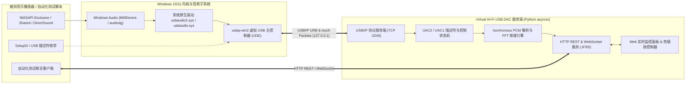

# Virtual Hi-Fi USB DAC

[-0078D6?logo=windows)](https://github.com/HZX0831/virtual-usb-dac)
[](https://www.python.org/)
[](https://www.usb.org/documents)
[](https://learn.microsoft.com/en-us/windows/win32/coreaudio/exclusive-mode-streams)

**Virtual Hi-Fi USB DAC** 是一套面向 Windows 音频播放器研发与自动化测试的 **USB 协议级虚拟声卡与音频输出验证平台**。

在无物理声卡/耳机插入的开发机、CI 服务器或虚拟机环境中，本项目通过微软 WHQL 签名的 `usbip-win2` 虚拟 USB 总线驱动与纯 Python `asyncio` USB/IP 服务端，在 Windows 设备管理器中挂载一个真实的 **USB Audio Class 2.0 (UAC2) / 1.0 (UAC1)** 硬件设备，驱动系统原生 `usbaudio2.sys` / `usbaudio.sys` 创建标准音频端点，并对接收到的底层 USB 控制指令与原始 PCM 音频流进行实时解包、频谱分析与录制校验。

---

## 核心特性

- **真实 Windows USB 硬件节点模拟**
  - 在设备管理器中生成真实的 `USB Composite Device` 与音频控制器节点（支持自定义 `VID`、`PID`、厂商名、产品名与序列号）。
  - 无需开启 Windows 测试签名模式（Test Signing Mode），无需重启系统。
- **全规格 Hi-Fi 音频与 WASAPI 独占模式（Exclusive Mode）支持**
  - 原生支持 **USB Audio Class 2.0**（High-Speed 480Mbps）与 **USB Audio Class 1.0** 协议切换。
  - 支持 `44.1kHz`、`48kHz`、`88.2kHz`、`96kHz`、`176.4kHz`、`192kHz` 共 6 档采样率与 `16-bit`、`24-bit`、`32-bit` 共 3 档位深（总计 **18 种无损 PCM 格式组合**）。
  - 完整支持 **WASAPI 独占模式（Exclusive Mode）**、**WASAPI 共享模式（Shared Mode）**、**DirectSound**、**MME** 与 **WDM-KS**，并支持通过 `SetupDi` / `CfgMgr32` / `libusb` 枚举底层 USB 描述符。
- **高精度虚拟晶振时钟（Virtual Crystal Oscillator）**
  - 内置 1ms 级高精度虚拟硬件时钟节拍器，严格按照当前协商采样率实时消费 USB Isochronous OUT 微帧数据包，确保播放器进度条与真实物理声卡完全一致。
- **实时音频特征分析与 Bit-Perfect 录音验证**
  - 实时解包 16/24/32-bit 原始 USB PCM 数据流，计算左右声道 **RMS 均方根电平 (dBFS)**、**Peak 峰值电平 (dBFS)**、**静音状态检测**。
  - 内置加窗 FFT（Hanning Window + 抛物线插值）实时计算左右声道 **主频率 (Hz)** 及 **32 段频谱**。
  - 支持将 USB 总线上收到的原始 PCM 字节流直接保存为 `.wav` 文件并输出 `SHA-256` 校验值，用于检验独占模式是否做到了真正的 Bit-Perfect 比特完美传输。
- **HTTP REST / WebSocket 自动化控制与故障注入**
  - 提供完整的 REST API 与 WebSocket 实时遥测流，支持自动化测试脚本断言播放状态、验证硬件采样率/位深切换、动态模拟 **USB 热插拔（Attach / Detach）** 以及 **注入 URB 传输错误**。
- **内置 Web 实时监控台**
  - 零前端构建依赖，启动服务后浏览器访问 `http://127.0.0.1:8765` 即可查看硬件协商状态、双声道电平表、实时示波器波形、FFT 频谱图与 USB 控制传输日志。

---

## 系统架构



---

## 目录结构

```text
virtual-usb-dac/
├── main.py                     # 模拟器主程序入口（启动 USB/IP 与 HTTP/WS 服务）
├── requirements.txt            # Python 依赖包列表
├── scripts/
│   └── setup_driver.ps1        # 自动下载/安装 usbip-win2 签名驱动与挂载管理脚本
├── usb_dac/
│   ├── __init__.py
│   ├── config.py               # 虚拟声卡配置模型（VID/PID、采样率、位深、端口）
│   ├── uac_descriptors.py      # UAC 2.0 / UAC 1.0 标准与类特定描述符二进制构建器
│   ├── usbip_server.py         # USB/IP v1.1.1 协议服务端、EP0 控制状态机与虚拟晶振
│   ├── api_server.py           # aiohttp REST API 与 WebSocket 遥测服务端
│   └── static/
│       └── index.html          # 内置可视化实时监控面板 (Web UI)
└── tests/
    ├── test_usb_dac.py         # 描述符、音频分析器与 USB/IP 协议栈单元测试
    └── verify_wasapi.py        # WASAPI 共享模式与独占模式端到端闭环验证及参考实现
```

---

## 环境要求

- **操作系统**：Windows 10 (版本 1903 及以上) 或 Windows 11 (x64)
- **Python**：Python 3.8 或更高版本
- **权限要求**：首次安装 `usbip-win2` 虚拟 USB 总线驱动时需要管理员权限（驱动具有微软 WHQL/Attestation 签名，无需开启测试模式）

---

## 快速开始

### 1. 克隆仓库并安装 Python 依赖

```powershell
git clone https://github.com/HZX0831/virtual-usb-dac.git
cd virtual-usb-dac
python -m pip install -r requirements.txt
```

### 2. 安装虚拟 USB 总线驱动（仅首次需要）

运行以下命令自动下载并静默安装微软签名的 `usbip-win2` 驱动（若弹出 UAC 提示请点击允许）：

```powershell
powershell -ExecutionPolicy Bypass -File scripts/setup_driver.ps1
```

### 3. 启动虚拟 USB 声卡并自动挂载

```powershell
python main.py --auto-attach
```

启动成功后：
1. Windows 设备管理器与声音设置中将立即出现 **`扬声器 (Virtual Hi-Fi USB DAC)`**。
2. 打开浏览器访问 **http://127.0.0.1:8765** 即可打开实时监控面板。

---

## 命令行参数说明 (`main.py`)

```text
usage: main.py [-h] [--usbip-port USBIP_PORT] [--api-port API_PORT]
               [--uac {1,2}] [--vid VID] [--pid PID] [--product PRODUCT]
               [--auto-attach]
```

| 参数 | 默认值 | 说明 |
| :--- | :--- | :--- |
| `--auto-attach` | `False` | 启动后自动调用 `usbip.exe attach` 将虚拟声卡挂载到 Windows |
| `--uac` | `2` | USB Audio Class 协议版本：`2` (UAC 2.0, `usbaudio2.sys`) 或 `1` (UAC 1.0, `usbaudio.sys`) |
| `--vid` | `0x1209` | 自定义 USB Vendor ID（支持十六进制如 `0x1209`） |
| `--pid` | `0xF001` | 自定义 USB Product ID（支持十六进制如 `0xF001`） |
| `--product` | `"Virtual Hi-Fi USB DAC"` | 自定义 USB 设备产品名称（显示在 Windows 声音设备列表中） |
| `--usbip-port` | `3240` | 本地 USB/IP 协议监听端口 |
| `--api-port` | `8765` | 本地 HTTP REST / WebSocket 与监控面板监听端口 |

---

## HTTP REST & WebSocket 接口文档

所有接口默认监听于 `http://127.0.0.1:8765`。

### 1. 查询设备与实时音频流状态 — `GET /api/status`

返回当前 USB 硬件协商参数（采样率、位深、Alternate Setting、硬件音量/静音）与实时 PCM 音频流特征（是否在播放、是否静音、左右声道 RMS/Peak 分贝、FFT 主频率、实时码率等）。

**响应示例：**
```json
{
  "ok": true,
  "driver": {
    "usbip_exe": "C:\\Program Files\\USBip\\usbip.exe",
    "installed": true
  },
  "hardware": {
    "attached": true,
    "client_addr": "127.0.0.1:55271",
    "uac_version": 2,
    "vid": "0x1209",
    "pid": "0xF001",
    "manufacturer": "Antigravity Audio Lab",
    "product": "Virtual Hi-Fi USB DAC",
    "serial": "AGY-DAC-0001",
    "bus_id": "1-1",
    "alt_setting": 2,
    "sample_rate": 96000,
    "bit_depth": 24,
    "subframe_size": 3,
    "channels": 2,
    "mute": false,
    "volume_db": 0.0,
    "supported_sample_rates": [44100, 48000, 88200, 96000, 176400, 192000],
    "inject_error_remaining": 0
  },
  "audio": {
    "is_playing": true,
    "is_silent": false,
    "rms_db": -9.03,
    "peak_db": -6.02,
    "rms_db_left": -9.03,
    "rms_db_right": -9.03,
    "peak_db_left": -6.02,
    "peak_db_right": -6.02,
    "dominant_freq_hz": 1500.0,
    "dominant_freq_left_hz": 1500.0,
    "dominant_freq_right_hz": 1500.0,
    "total_packets": 960,
    "total_bytes": 691200,
    "total_frames": 115200,
    "bitrate_kbps": 4608.0,
    "is_recording": false
  }
}
```

### 2. 查询底层 USB 控制传输日志 — `GET /api/usb/logs?limit=100`

用于验证播放器的 **WASAPI 独占模式** 是否真正向 USB 声卡下发了硬件时钟频率切换（`CLOCK_RATE_SET`）与接口位深切换（`SET_INTERFACE`）。

**响应示例：**
```json
{
  "ok": true,
  "count": 3,
  "logs": [
    {
      "timestamp": 1794536021.12,
      "time_str": "10:13:41",
      "type": "CLOCK_RATE_SET",
      "detail": "UAC2 Clock Sample Rate set to 96000 Hz",
      "sample_rate": 96000
    },
    {
      "timestamp": 1794536021.15,
      "time_str": "10:13:41",
      "type": "SET_INTERFACE",
      "detail": "AudioStreaming Alt=2 active (24-bit, 2ch @ 96000Hz)",
      "alt_setting": 2,
      "bit_depth": 24,
      "sample_rate": 96000
    }
  ]
}
```

### 3. 模拟设备热插拔与异常注入

| 接口 | 方法 | 请求体示例 | 说明 |
| :--- | :--- | :--- | :--- |
| `/api/device/plug` | `POST` | `{}` | 动态挂载虚拟 USB 声卡，触发 Windows 设备插入事件 |
| `/api/device/unplug` | `POST` | `{}` | 动态拔出虚拟 USB 声卡，测试播放器断连恢复与输出设备回退 |
| `/api/device/inject-error` | `POST` | `{"count": 20, "status": -71}` | 向后续 `count` 个 USB Isochronous URB 注入协议错误，测试播放器容错 |
| `/api/device/config` | `POST` | `{"vid": "0x1209", "pid": "0xF002", "product": "Custom DAC", "uac_version": 2, "replug": true}` | 动态修改 USB 硬件标识或切换 UAC1/UAC2 并自动重新挂载 |

### 4. 原始 USB PCM 音频录制与校验

- **开始录制**：`POST /api/capture/start`（可选参数 `{"filename": "test_exclusive.wav"}`）
- **停止录制**：`POST /api/capture/stop`
  ```json
  {
    "ok": true,
    "recording": {
      "path": "G:\\virtual-usb-dac\\captures\\test_exclusive.wav",
      "bytes_captured": 691200,
      "frames_captured": 115200,
      "duration_sec": 1.2,
      "sample_rate": 96000,
      "bit_depth": 24,
      "channels": 2,
      "sha256": "cdb2313a3b206e80..."
    }
  }
  ```

### 5. WebSocket 实时遥测流 — `WS /ws/telemetry`

连接 `ws://127.0.0.1:8765/ws/telemetry` 后，服务端以约 12~15Hz 推送包含 `hardware`、`audio`（含 64 点时域波形 `waveform_preview` 与 32 段频谱 `spectrum_preview`）以及最新 `logs` 的 JSON 消息。

---

## 验证与测试套件

### 1. 运行单元测试

验证 UAC2/UAC1 描述符边界合法性、16/24/32-bit PCM 解包与 FFT 频率计算精度、以及 USB/IP 服务端协议闭环：

```powershell
python -m unittest discover -s tests -p "test_*.py" -v
```

### 2. 运行 WASAPI 共享与独占模式端到端闭环验证

在虚拟声卡服务运行期间，执行端到端验证脚本（同时也是完整的 **Windows WASAPI Exclusive Mode 独占输出参考实现**）：

```powershell
python tests/verify_wasapi.py
```

该脚本将依次自动执行并断言：
1. 检查 Windows `MMDevice` 列表中是否已激活 `扬声器 (Virtual Hi-Fi USB DAC)`。
2. 遍历测试 `44.1kHz ~ 192kHz` × `16/24/32-bit` 全部 **18 种格式**在 `IAudioClient::IsFormatSupported(AUDCLNT_SHAREMODE_EXCLUSIVE)` 下的原生支持情况。
3. 通过 **WASAPI 共享模式** 播放 `440 Hz` 正弦波并录制 WAV，断言服务端检测到的主频率约为 `440 Hz`。
4. 通过 **WASAPI 独占模式 (`AUDCLNT_SHAREMODE_EXCLUSIVE`)** 分别以：
   - `44100 Hz / 16-bit` 播放 `1000 Hz` 测试音
   - `96000 Hz / 24-bit` 播放 `1500 Hz` 测试音
   - `192000 Hz / 32-bit` 播放 `2000 Hz` 测试音
   并向 `/api/status` 断言虚拟 USB 声卡硬件真实切换到了对应的 `Alt Setting`、采样率与位深，且 FFT 检测到的音频主频与输出频率一致。
5. 调用 API 验证错误注入与 USB 动态拔出/重连恢复。

---

## License

MIT License
